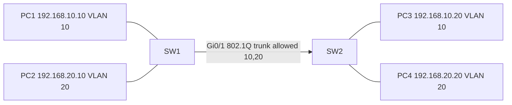

# Lab 01 — VLAN + trunk

Hands-on lab for Cisco Packet Tracer (not a production network). Configs are for Catalyst 2960 switches.

## Goal

Two switches share VLAN 10 (Staff) and VLAN 20 (Guests) over an 802.1Q trunk. Hosts in the **same** VLAN can reach each other through the trunk. Hosts in **different** VLANs cannot, because there is no router in this lab.

## Devices and addressing

| Device | Port | Mode | VLAN / link | Endpoint |
| --- | --- | --- | --- | --- |
| SW1 | Fa0/1 | access | VLAN 10 | PC1 `192.168.10.10/24` |
| SW1 | Fa0/2 | access | VLAN 20 | PC2 `192.168.20.10/24` |
| SW1 | Gi0/1 | trunk | allowed 10,20 | SW2 Gi0/1 |
| SW2 | Fa0/1 | access | VLAN 10 | PC3 `192.168.10.20/24` |
| SW2 | Fa0/2 | access | VLAN 20 | PC4 `192.168.20.20/24` |
| SW2 | Gi0/1 | trunk | allowed 10,20 | SW1 Gi0/1 |

PCs need no default gateway for same-VLAN pings. Leave the trunk native VLAN at the default (1) and do not put user hosts in VLAN 1.

## Packet Tracer build

1. Place two **2960** switches and four PCs as in the table.
2. Copper straight-through: each PC to its access port. Copper crossover or auto-mdix between SW1 Gi0/1 and SW2 Gi0/1 (Packet Tracer often accepts either).
3. Paste `SW1.cfg` and `SW2.cfg` (or type them). Set the PC IP addresses and masks; leave the gateway empty.
4. On a **3560**, add `switchport trunk encapsulation dot1q` *before* `switchport mode trunk`. On a **2960** that command does not exist — do not add it.

## Topology



A rendered diagram is in `topology.svg`.

## Verification

On SW1 or SW2:

```
show vlan brief
show interfaces trunk
show interfaces gigabitEthernet 0/1 switchport
```

You should see VLAN 10 and 20 active, and Gi0/1 as a trunk allowing 10 and 20.

From the PCs (Packet Tracer PDU or Command Prompt):

- PC1 ping 192.168.10.20 — should succeed (same VLAN, through the trunk)
- PC2 ping 192.168.20.20 — should succeed
- PC1 ping 192.168.20.10 — should fail (different VLAN, no router)
