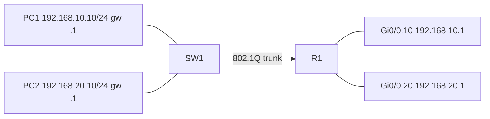

# Lab 02 — Inter-VLAN routing (router-on-a-stick)

Hands-on lab for Cisco Packet Tracer. Switch: 2960. Router: 2911 (or 1941 / 2811 — any router with a GigabitEthernet interface that supports subinterfaces).

## Goal

A single physical router interface, with two 802.1Q subinterfaces, routes between VLAN 10 and VLAN 20. This is called router-on-a-stick.

## Devices and addressing

| Device | Port | Address / mode |
| --- | --- | --- |
| PC1 Staff | SW1 Fa0/1, VLAN 10 | `192.168.10.10/24`, gateway `192.168.10.1` |
| PC2 Guest | SW1 Fa0/2, VLAN 20 | `192.168.20.10/24`, gateway `192.168.20.1` |
| SW1 Gi0/1 | trunk, allowed 10,20 | to R1 Gi0/0 |
| R1 Gi0/0 | physical, no IP | `no shutdown` |
| R1 Gi0/0.10 | `encapsulation dot1Q 10` | `192.168.10.1/24` |
| R1 Gi0/0.20 | `encapsulation dot1Q 20` | `192.168.20.1/24` |

The physical interface has no IP address. The gateways live on the subinterfaces. `encapsulation dot1Q` is required on the router (this is not the same command as on a 3560 switch).

## Packet Tracer build

1. One 2960, one 2911, two PCs.
2. Copper: PCs to Fa0/1 and Fa0/2; SW1 Gi0/1 to R1 Gi0/0.
3. Paste `SW1.cfg` and `R1.cfg`. Set PC IPs **and** default gateways.

## Topology



See `topology.svg`.

## Verification

On R1:

```
show ip interface brief
show vlans
show ip route
```

You should see G0/0.10 and G0/0.20 up, and two connected routes (`C`) for 192.168.10.0/24 and 192.168.20.0/24.

On SW1: `show interfaces trunk` — Gi0/1 should be trunking 10 and 20.

From the PCs:

- PC1 ping 192.168.10.1 — gateway in its own VLAN
- PC2 ping 192.168.20.1 — gateway in its own VLAN
- PC1 ping 192.168.20.10 — should succeed (routed on R1)
- PC1 ping 192.168.20.1 — should also succeed
