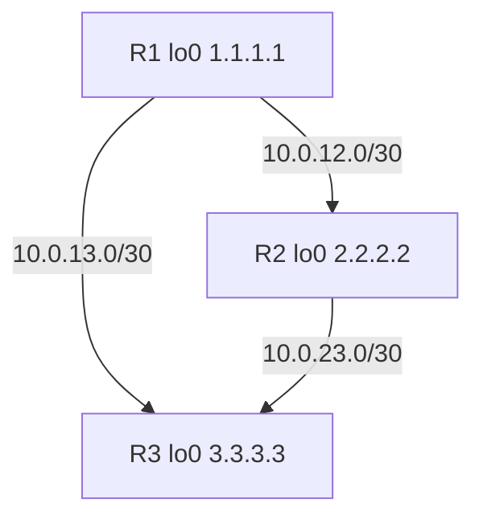

# Lab 03 — OSPF single area

Hands-on lab for Cisco Packet Tracer. Three Cisco 2911 routers, all in OSPF area 0 (the backbone). No switches are required.

## Goal

Each router forms OSPF neighbors on its two physical links, advertises a loopback /32, and can ping the other routers' loopbacks.

## Addressing

| Link | Network | R1 | R2 | R3 |
| --- | --- | --- | --- | --- |
| R1–R2 | 10.0.12.0/30 | Gi0/0 `.1` | Gi0/0 `.2` | — |
| R1–R3 | 10.0.13.0/30 | Gi0/1 `.1` | — | Gi0/0 `.2` |
| R2–R3 | 10.0.23.0/30 | — | Gi0/1 `.1` | Gi0/1 `.2` |
| Loopback0 | /32 | 1.1.1.1 | 2.2.2.2 | 3.3.3.3 |

Wildcard for a /30 is `0.0.0.3`. Wildcard for a /32 is `0.0.0.0`. OSPF process ID is `1` on all three routers (it only has to match locally, but using the same value keeps the lab readable). `router-id` is set to the loopback address so IDs are stable and easy to recognise in `show ip ospf neighbor`.

## Packet Tracer build

1. Place three 2911 routers. Connect the three GigabitEthernet links as in the table (copper crossover or auto-mdix).
2. Paste `R1.cfg`, `R2.cfg`, `R3.cfg`.
3. Wait a few seconds for OSPF to reach FULL.

## Topology



See `topology.svg`.

## Verification

On each router:

```
show ip ospf neighbor
show ip route ospf
show ip protocols
```

Each router should show **two** neighbors in state **FULL**. The OSPF routing table should contain the other two loopbacks (`O` or `O IA` is not expected here — they are intra-area, so `O`) and the opposite /30 if not already connected.

Pings:

```
ping 2.2.2.2
ping 3.3.3.3
```

From R1, both should succeed. Optional, to force the loopback as the source:

```
ping 2.2.2.2 source 1.1.1.1
```
