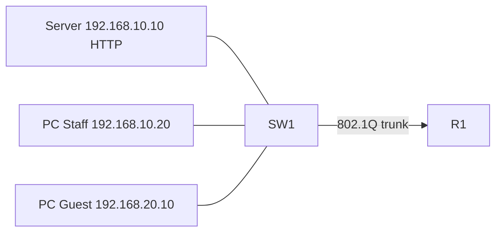

# Lab 04 — Standard and extended ACL

Hands-on lab for Cisco Packet Tracer. Reuses the router-on-a-stick topology from Lab 02, then adds access lists. Switch: 2960. Router: 2911.

**Apply only one ACL variant at a time.** Start from `R1.cfg`, then add either `R1-standard-acl.cfg` or `R1-extended-acl.cfg`. If you tested the standard ACL first, remove it before the extended one (commands are in that file).

## Goal

- **Standard ACL (variant A):** block the whole Guest network from reaching the Staff network. Standard ACLs match only the source address, so they are placed **close to the destination** (outbound on G0/0.10).
- **Extended ACL (variant B):** allow Guest HTTP only to the Staff web server `192.168.10.10`, and deny any other Guest-to-Staff traffic. Extended ACLs can match source, destination and protocol, so they are placed **close to the source** (inbound on G0/0.20).

## Devices and addressing

| Device | Port / VLAN | Address |
| --- | --- | --- |
| Server (HTTP) | SW1 Fa0/1, VLAN 10 | `192.168.10.10/24`, gateway `192.168.10.1` |
| PC Staff | another access port in VLAN 10, or use a second PC on a spare Fa0/3 in VLAN 10 | `192.168.10.20/24`, gateway `192.168.10.1` |
| PC Guest | SW1 Fa0/2, VLAN 20 | `192.168.20.10/24`, gateway `192.168.20.1` |
| R1 G0/0.10 | VLAN 10 gateway | `192.168.10.1/24` |
| R1 G0/0.20 | VLAN 20 gateway | `192.168.20.1/24` |

If you only have one Staff endpoint, the HTTP server is enough for the extended ACL test; add PC Staff if you want to show that HTTP to `.10` is allowed while ping to `.20` is not.

In Packet Tracer, use a **Server** device, set its IP, and leave HTTP service on.

## Topology



See `topology.svg`.

## Verification

Shared, after the base config (no ACL yet): Guest can ping 192.168.10.10 and 192.168.10.1.

**After the standard ACL:**

```
show access-lists 10
```

- Guest ping 192.168.10.10 — should fail
- Staff ping 192.168.10.1 — should still work
- Hit counts on the `deny` line should increase after a failed Guest ping

**After the extended ACL** (standard ACL removed):

```
show access-lists GUEST_TO_STAFF
```

- From Guest, HTTP to 192.168.10.10 (Packet Tracer Web Browser or the HTTP PDU) — should succeed
- Guest ping 192.168.10.10 or 192.168.10.20 — should fail
- Staff traffic is not filtered by this inbound Guest ACL

Every ACL ends with an implicit `deny any`. That is why the standard list ends with `permit any`, and why the extended list ends with `permit ip any any`.
