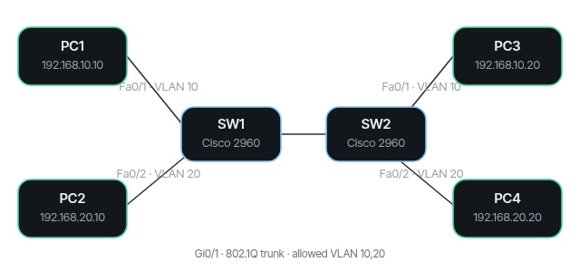
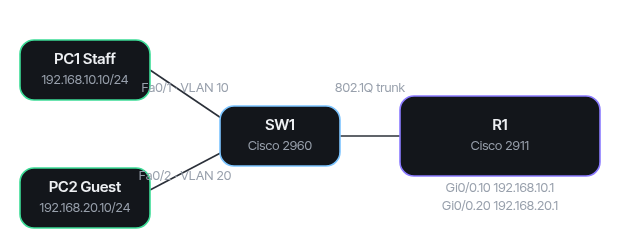
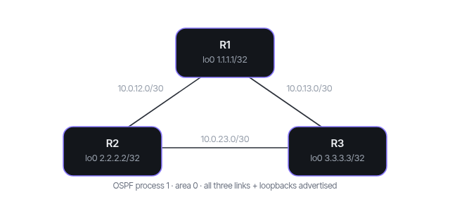
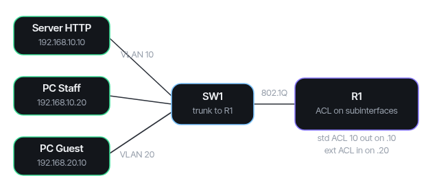

<div align="center">

<div style="font-size:64px">🔌</div>

# CCNA Packet Tracer Labs

**Four ready-to-build Cisco labs with configs, diagrams and verification — explained, not memorised.**

  <a href="https://ccna-labs-demo.vercel.app"></a>
  <a href="https://github.com/LucianCeusanRo/ccna-packet-tracer-labs/actions/workflows/ci.yml"></a>
  <a href="LICENSE"></a>
  
  <a href="https://github.com/LucianCeusanRo/ccna-packet-tracer-labs/stargazers"></a>
  <a href="https://github.com/LucianCeusanRo/ccna-packet-tracer-labs/commits/main"></a>

[English](#-about) · [Română](#-română)

</div>

<p align="center"></p>

<p align="center"><strong><a href="https://ccna-labs-demo.vercel.app">▶ Live demo</a></strong> — open it in the browser and try it yourself.</p>

## 📑 Table of contents

- [📖 About](#-about)
- [✨ Features](#-features)
- [🧠 How it works](#-how-it-works)
- [⚡ Quick start](#-quick-start)
- [📚 Step-by-step tutorial](#-step-by-step-tutorial)
- [🔧 Configuration](#-configuration)
- [🗂️ Project structure](#-project-structure)
- [⚠️ Limitations](#-limitations)
- [❓ FAQ](#-faq)
- [🗺️ Roadmap](#-roadmap)
- [🤝 Contributing](#-contributing)
- [📄 License](#-license)
- [🇷🇴 Română](#-română)
- [👤 Author](#-author)

## 📖 About

Four hands-on Cisco IOS labs I built in Cisco Packet Tracer while studying for the CCNA. Each lab has a topology diagram, ready-to-paste device configs, step-by-step build notes and the verification commands with the expected result. These are practice labs, not production networks.

- **What:** small, self-contained labs (`.cfg` + diagram + README per lab) and Romanian study notes (`LEARN.md`) that explain *why* each command works and the usual mistakes.
- **What it is used for:** rebuilding a classic CCNA scenario in 10–20 minutes, checking your own config against a working one, and preparing to explain the commands in an interview.
- **Who it helps:** CCNA / network-technician students, Romanian speakers who want explanations in their language, and trainers who need quick demo topologies.

## ✨ Features

| # | Lab | What it shows | Topology |
| --- | --- | --- | --- |
| 01 | [VLAN + trunk](01-vlan-trunk/) | Two 2960 switches share VLAN 10/20 over an 802.1Q trunk; DTP off, PortFast on access ports |  |
| 02 | [Inter-VLAN routing](02-inter-vlan/) | Router-on-a-stick: one 2911 interface with 802.1Q subinterfaces routes between VLANs |  |
| 03 | [OSPF single area](03-ospf/) | Three 2911 routers in area 0, loopbacks advertised, neighbor and route verification |  |
| 04 | [Standard & extended ACL](04-acl/) | Block Guest → Staff with a standard ACL, or allow only HTTP to one server with an extended ACL |  |

**Skills covered:** VLANs, 802.1Q trunking, DTP, STP PortFast, router-on-a-stick, subinterfaces, OSPFv2 single area, loopbacks, standard and extended ACLs, IOS verification and troubleshooting.

## 🧠 How it works


Every lab follows the same five steps, so you always know where to look. `LEARN.md` explains each command in Romanian with the usual mistakes.

**Tech stack:** Cisco Packet Tracer 8.x, Cisco IOS CLI, SVG diagrams.

## ⚡ Quick start

```bash
git clone https://github.com/LucianCeusanRo/ccna-packet-tracer-labs.git
cd ccna-packet-tracer-labs/01-vlan-trunk && cat SW1.cfg   # paste into SW1 > CLI > configure terminal
```

## 📚 Step-by-step tutorial

1. **Install** Cisco Packet Tracer 8.x (free with a Cisco Networking Academy account) and clone this repo:
   ```bash
   git clone https://github.com/LucianCeusanRo/ccna-packet-tracer-labs.git
   ```
   No `.env` or other configuration is needed.
2. **Build the topology:** place two **2960** switches and four PCs; cable PC1/PC2 to SW1 Fa0/1–Fa0/2, PC3/PC4 to SW2 Fa0/1–Fa0/2, and SW1 Gi0/1 ↔ SW2 Gi0/1.
3. **Configure:** open SW1 → *CLI* → `enable` → `configure terminal` → paste `01-vlan-trunk/SW1.cfg`. Do the same for SW2. Give the PCs `192.168.10.10`, `192.168.20.10`, `192.168.10.20`, `192.168.20.20` /24 (no gateway).
4. **Verify:**
   ```
   SW1# show vlan brief            → VLAN 10 Staff and 20 Guests active, Fa0/1 in 10, Fa0/2 in 20
   SW1# show interfaces trunk      → Gi0/1 trunking, allowed VLANs 10,20
   ```
   PC1 → `ping 192.168.10.20` succeeds; PC1 → `ping 192.168.20.10` fails (different VLAN, no router — that is the point).
5. **Continue:** Lab 02 adds the router that makes the failing ping work; Lab 03 is routing between three routers; Lab 04 filters traffic.
6. **Learn the why:** read the matching chapter in [`LEARN.md`](LEARN.md) and try the "common mistake" on purpose to see how it breaks.

## 🔧 Configuration

No configuration or secrets are needed — only Cisco Packet Tracer 8.x.

## 🗂️ Project structure

```
01-vlan-trunk/   SW1.cfg, SW2.cfg, topology.svg, README.md
02-inter-vlan/   R1.cfg, SW1.cfg, topology.svg, README.md
03-ospf/         R1.cfg, R2.cfg, R3.cfg, topology.svg, README.md
04-acl/          R1.cfg, R1-standard-acl.cfg, R1-extended-acl.cfg, SW1.cfg, topology.svg, README.md
LEARN.md         Romanian study notes: why each command works, common mistakes
docs/screenshots rendered topology images
tests/         CI: parse every .cfg and check README links
```

## ⚠️ Limitations

- Packet Tracer simulates a subset of IOS; some commands behave differently on real hardware (e.g. `switchport trunk encapsulation dot1q` exists on 3560 but not on 2960).
- No `.pkt` files are included — you build the topology yourself (that is part of the exercise).
- Only four CCNA-level topics; no IPv6, EtherChannel, NAT, DHCP or wireless yet.
- Security settings (passwords, SSH, port security) are deliberately left out to keep each lab focused.

---

## ❓ FAQ

<details><summary><b>Do I need real Cisco hardware?</b></summary>

No, everything is built and tested in Packet Tracer. Most commands also work on real 2960/2911 devices.

</details>

<details><summary><b>Why is there no .pkt file?</b></summary>

Building and cabling the topology yourself is part of the exercise.

</details>

<details><summary><b>`switchport trunk encapsulation dot1q` is rejected — why?</b></summary>

The 2960 only supports 802.1Q, so the command does not exist there; on a 3560 it is required before `switchport mode trunk`.

</details>

## 🗺️ Roadmap

- [ ] Lab 05 — DHCP and NAT/PAT
- [ ] Lab 06 — EtherChannel (LACP)
- [ ] Lab 07 — SSH hardening and port security
- [ ] IPv6 addressing lab

## 🤝 Contributing

Found a mistake or have a lab idea? Open an issue or a PR with the config, the topology and the verification output.

## 📄 License

MIT — see [LICENSE](LICENSE).

## 🇷🇴 Română

<details>
<summary><b>Click pentru versiunea în limba română</b></summary>

Patru laboratoare practice de Cisco IOS, făcute în Cisco Packet Tracer în timp ce învăț pentru CCNA. Fiecare are diagrama topologiei, configurațiile gata de lipit, pașii de construire și comenzile de verificare cu rezultatul așteptat. Sunt laboratoare de exercițiu, nu rețele de producție.

#### Ce este și pe cine ajută
- **Ce:** laboratoare mici (`.cfg` + diagramă + README) și notițe în română (`LEARN.md`) care explică *de ce* merge fiecare comandă și greșelile frecvente.
- **La ce folosește:** refaci un scenariu clasic CCNA în 10–20 de minute, îți compari configurația cu una care merge și te pregătești să explici comenzile la interviu.
- **Pe cine ajută:** cursanți CCNA / tehnicieni de rețea, vorbitori de română și instructori care au nevoie de topologii demo rapide.

| # | Laborator | Ce demonstrează |
| --- | --- | --- |
| 01 | [VLAN + trunk](01-vlan-trunk/) | Două switch-uri 2960 împart VLAN 10/20 printr-un trunk 802.1Q; DTP oprit, PortFast pe porturile access |
| 02 | [Rutare inter-VLAN](02-inter-vlan/) | Router-on-a-stick: o interfață a unui 2911, cu subinterfețe 802.1Q, rutează între VLAN-uri |
| 03 | [OSPF o singură zonă](03-ospf/) | Trei routere 2911 în area 0, loopback-uri anunțate, verificare vecini și rute |
| 04 | [ACL standard și extins](04-acl/) | Blocare Guest → Staff cu ACL standard, sau doar HTTP către un server cu ACL extins |

#### Cum sunt organizate
Fiecare laborator are: obiectiv → tabel cu echipamente și adrese → construire în Packet Tracer → configurații → verificare.

#### Tutorial pas cu pas (laboratorul 01)
1. Instalează Cisco Packet Tracer 8.x și clonează repo-ul (nu e nevoie de `.env`).
2. Pune două switch-uri **2960** și patru PC-uri; cablează PC1/PC2 la SW1 Fa0/1–Fa0/2, PC3/PC4 la SW2, și SW1 Gi0/1 ↔ SW2 Gi0/1.
3. Pe SW1: *CLI* → `enable` → `configure terminal` → lipește `01-vlan-trunk/SW1.cfg`; la fel pe SW2. Adrese PC: `192.168.10.10`, `192.168.20.10`, `192.168.10.20`, `192.168.20.20` /24, fără gateway.
4. Verifică: `show vlan brief`, `show interfaces trunk`. Ping PC1 → 192.168.10.20 merge; PC1 → 192.168.20.10 nu merge (alt VLAN, fără rutier — asta e ideea).
5. Continuă cu laboratorul 02 (rutierul care face ping-ul să meargă), 03 (OSPF) și 04 (ACL).
6. Citește capitolul din [`LEARN.md`](LEARN.md) și provoacă intenționat „greșeala frecventă”.

#### Structura proiectului
Vezi lista de mai sus: câte un folder pe laborator, `LEARN.md`, `docs/screenshots`.

#### Limitări
- Packet Tracer simulează doar o parte din IOS; unele comenzi diferă pe echipamente reale.
- Nu sunt incluse fișiere `.pkt` — topologia o construiești tu.
- Doar patru teme CCNA; încă fără IPv6, EtherChannel, NAT, DHCP, wireless.
- Parolele, SSH și port security sunt lăsate deoparte intenționat.

</details>

## 👤 Author

**Lucian-Ciprian Ceușan** — telecom & network technician, Bucharest, Romania

[](https://lucian-ceusan.vercel.app) [](https://www.linkedin.com/in/lucian-ceusan-7a9179210) [](https://github.com/LucianCeusanRo)
